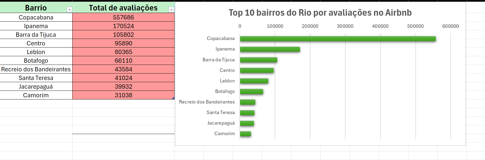

# Airbnb no Rio de Janeiro: onde está o movimento?

Análise exploratória de **48 mil anúncios** e **1,4 milhão de avaliações** do Airbnb no Rio de Janeiro, usando **SQL (com `JOIN`)** e **Excel**.



## Sumário

- [Contexto](#contexto)
- [Perguntas de negócio](#perguntas-de-negócio)
- [Dados](#dados)
- [Principais descobertas](#principais-descobertas)
- [Qualidade dos dados](#qualidade-dos-dados)
- [Consultas SQL](#consultas-sql)
- [Como reproduzir](#como-reproduzir)
- [Estrutura do repositório](#estrutura-do-repositório)
- [Aprendizados](#aprendizados)
- [Próximos passos](#próximos-passos)
- [Autor](#autor)

## Contexto

O Rio de Janeiro é um dos maiores mercados de hospedagem por temporada do Brasil. Entender **onde está a demanda** e **quanto custa cada tipo de imóvel** ajuda anfitriões a precificar e investidores a escolher onde atuar.

Este projeto usa dados públicos do Airbnb para responder essas perguntas com SQL, e também para avaliar **o quanto os dados são confiáveis**.

## Perguntas de negócio

1. Quais bairros concentram mais **movimento** (avaliações)?
2. Quanto custa, em média, cada **tipo de imóvel**?
3. Quais bairros têm o **maior preço médio**, e esse ranking é confiável?

## Dados

- **Fonte:** [Inside Airbnb](https://insideairbnb.com/get-the-data/), cidade do Rio de Janeiro
- **`listings`:** 48.247 anúncios (bairro, tipo de quarto, preço, etc.)
- **`reviews`:** 1.461.658 avaliações
- **Ligação entre as tabelas:** `listings.id = reviews.listing_id`

**Ferramentas:** MySQL Workbench (consultas) e Excel (tabela e gráfico).

## Principais descobertas

### 1. Copacabana lidera em movimento

Copacabana concentra **mais de um terço** das avaliações e tem mais que o triplo do 3º colocado.

| Posição | Bairro | Avaliações |
|---------|--------|-----------|
| 1 | Copacabana | 557.686 |
| 2 | Ipanema | 170.524 |
| 3 | Barra da Tijuca | 105.802 |
| 4 | Centro | 95.890 |
| 5 | Leblon | 80.365 |
| 6 | Botafogo | 66.110 |
| 7 | Recreio dos Bandeirantes | 43.584 |
| 8 | Santa Teresa | 41.024 |
| 9 | Jacarepaguá | 39.932 |
| 10 | Camorim | 31.038 |

> Avaliações medem **movimento**, não qualidade. Bairros com mais anúncios tendem a acumular mais avaliações.

### 2. Casa inteira custa quase o dobro do quarto privado

| Tipo de imóvel | Anúncios | Preço médio |
|----------------|----------|-------------|
| Entire home/apt | 39.333 | 948,16 |
| Hotel room | 21 | 561,55 |
| Private room | 8.310 | 481,98 |
| Shared room | 582 | 216,96 |

### 3. O ranking de preço por bairro não é confiável como está

| Posição | Bairro | Anúncios | Preço médio |
|---------|--------|----------|-------------|
| 1 | Joá | 175 | 8.345,01 |
| 2 | Estácio | 84 | 6.862,26 |
| 3 | São Conrado | 586 | 2.828,35 |
| 4 | Itanhangá | 215 | 2.573,55 |
| 5 | Anchieta | 3 | 1.692,33 |
| 6 | Gávea | 234 | 1.560,09 |
| 7 | Coelho Neto | 8 | 1.547,63 |
| 8 | Alto da Boa Vista | 48 | 1.511,40 |
| 9 | Barra da Tijuca | 3.709 | 1.312,57 |
| 10 | Lagoa | 272 | 1.293,03 |

Bairros com **poucos anúncios** (Anchieta com 3, Coelho Neto com 8) entram no topo por qualquer valor alto. No Estácio, um único anúncio de 500.120 pesa muito: se ele for o único valor extremo do bairro, a média cairia de 6.862 para cerca de 920. O resultado mais sólido do topo é o da **Barra da Tijuca**, com 3.709 anúncios.

## Qualidade dos dados

- **Preços extremos:** o anúncio mais caro aparece com 587.008, e um anúncio chamado "test" aparece com 132.000. Valores assim **inflam as médias de preço**, inclusive o preço médio geral (860,49).
- **Linha com problema:** uma linha veio com o tipo de quarto igual a `11670`. Na importação, o MySQL emitiu 1 aviso na coluna `longitude`, e a suspeita é que essa linha esteja deslocada. Não foi investigada a fundo.

## Consultas SQL

Oito consultas, da mais simples à mais completa (código em [`consultas_airbnb.sql.sql`](consultas_airbnb.sql.sql)):

| # | Pergunta | Conceitos |
|---|----------|-----------|
| 1 | Como são os dados? | `SELECT`, `LIMIT` |
| 2 | Quais anúncios existem em Copacabana? | `WHERE` |
| 3 | Quais são os 10 anúncios mais caros? | `ORDER BY ... DESC` |
| 4 | Quantos anúncios existem e qual o preço médio? | `COUNT`, `AVG` |
| 5 | Qual o preço médio por bairro? | `GROUP BY` |
| 6 | Qual o preço médio por tipo de imóvel? | `GROUP BY` |
| 7 | Qual anúncio recebeu qual comentário? | `JOIN` |
| 8 | Quais bairros recebem mais avaliações? | `JOIN` + `GROUP BY` + `COUNT` |

Exemplo (consulta 8):

```sql
SELECT listings.neighbourhood, COUNT(reviews.comments)
FROM listings
JOIN reviews ON listings.id = reviews.listing_id
GROUP BY listings.neighbourhood
ORDER BY COUNT(reviews.comments) DESC
LIMIT 10;
```

## Como reproduzir

1. Baixe `listings.csv` e `reviews.csv` (versão detalhada, descompactada) do [Inside Airbnb](https://insideairbnb.com/get-the-data/), no Rio de Janeiro.
2. No **MySQL Workbench**, libere o carregamento de arquivos na conexão: **Edit Connection > Advanced > Others**, escreva `OPT_LOCAL_INFILE=1`, salve e reconecte.
3. Abra [`preparacao_banco.sql`](preparacao_banco.sql), troque os dois caminhos pelos dos seus arquivos e execute.
4. Confira os totais: **48.247** anúncios e **1.461.658** avaliações (podem variar conforme a data do download).
5. Execute as consultas de [`consultas_airbnb.sql.sql`](consultas_airbnb.sql.sql).

## Estrutura do repositório

```
projeto-airbnb-sql/
├── README.md
├── preparacao_banco.sql      # cria o banco, as tabelas e carrega os dados
├── consultas_airbnb.sql.sql  # as 8 consultas da análise
├── grafico_bairros.png.png   # gráfico do Top 10 de avaliações
├── ranking_bairros.xlsx.xlsx # planilha do Excel com o ranking
└── prints dos resultados das consultas
```

## Aprendizados

- **Conferir o total de linhas e os avisos** depois de importar. Na primeira carga, a tabela veio com quase 200 mil avisos porque faltava uma coluna (`host_profile_id`) na estrutura. Corrigindo, o aviso caiu para 1.
- O assistente de importação do Workbench falhou com os acentos do arquivo. O comando `LOAD DATA LOCAL INFILE` carregou tudo.
- **Média engana** quando há valores extremos e poucos registros por grupo.
- Arquivos com mais de 1 milhão de linhas não abrem no Excel.

## Próximos passos

- Tratar os preços extremos e recalcular as médias (por exemplo, ignorando bairros com poucos anúncios, com `HAVING`)
- Cruzar bairro, preço e avaliações
- Montar um painel no Power BI

## Autor

**Luis Eduardo**, estudante de Análise e Desenvolvimento de Sistemas (UNIPÊ).

- LinkedIn: _cole aqui o link do seu perfil_
- GitHub: _cole aqui o link do seu perfil_
